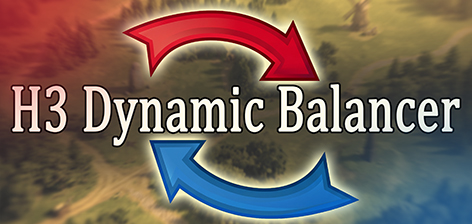

# H3 Dynamic Balancer

**H3 Dynamic Balancer** (by GoldFish & daemon_n) is an ERA 2.2+ mod that dynamically adjusts AI progression to match your pacing.

Every day, the system evaluates the total army strength ratio via background quick-combat simulations and mathematical models. When a power gap is detected, the script automatically applies resource buffs or penalties to computer opponents, leveling the field against early economic advantages and giving you a fighting chance for a comeback.

